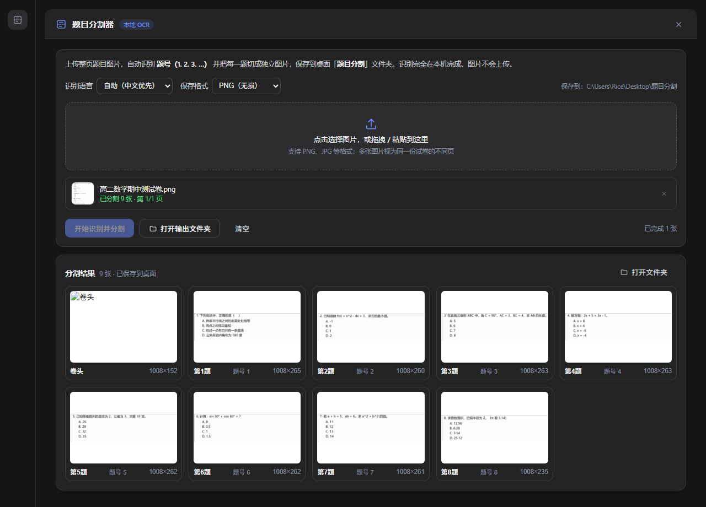

# 题目分割器 · dsh-question-splitter

[](https://www.microsoft.com/windows)
[](https://github.com/deepseek-ai)
[](LICENSE)

> 上传整页题目图片，自动识别**题号（1. 2. 3. …）**，把每一题切成独立图片并保存到桌面。
> 识别使用 Windows 自带的本地 OCR，**完全离线，图片不会上传**。

DeepSeek Harness（DSH）Desktop 插件：在左侧导航栏提供一个「题目分割」入口，打开后是一个独立主面板。



## 功能

- **题号识别**：行首 `1.` / `2．` / `3、` 等形式的题号，结合左边界与递增序列校验；OCR 漏识别个别题号时仍能继续。
- **按题切图**：在「上一题最后一行文字」与「下一题题号」之间找**墨迹最少的一行**切开，避免切穿文字；最后一题按墨迹分布确定内容底部，而不是图片底部。
- **卷头单独保存**：第一题之前若有标题 / 班级 / 得分等内容，保存为 `00_卷头.png`。
- **多页批量**：一次可上传多张图片（同一份试卷的不同页），输出文件名带 `P1_` / `P2_` 前缀。
- **格式可选**：PNG（无损）/ JPG（体积小，可调质量）。
- **手机照片友好**：读取并应用 EXIF 方向，横着拍的照片会自动摆正后再识别、切图。
- **结果预览**：面板内展示每张切图的缩略图、题号与尺寸；点击卡片可在资源管理器中定位文件。
- **离线**：只调用本机 `Windows.Media.Ocr`，不访问网络。


## 环境要求

| 项目 | 要求 |
| --- | --- |
| 操作系统 | Windows 10 / 11（插件依赖 `Windows.Media.Ocr` 与 PowerShell 5.1） |
| 宿主 | 已安装 DeepSeek Harness Desktop（实测 `0.2.1-rc.5`） |
| OCR 语言包 | 建议安装 Windows 的「中文(简体)」OCR 语言包（设置 → 时间和语言 → 语言 → 添加语言）；也可在面板中切换为 English |
| Node.js | 仅开发时需要（≥ 20） |

## 安装

### 方式 A：插件管理器（推荐）

1. 侧栏打开 **插件** → **添加插件**；
2. 填入 Git 地址 `https://github.com/Rice080401/dsh-question-splitter`（或本地目录）；
3. 安装完成后点击 **立即启用**；
4. 左侧导航栏出现「题目分割」图标即安装成功。

### 方式 B：命令行

```powershell
dsh plugin --profile desktop add github:Rice080401/dsh-question-splitter
```

然后在 **插件** 页面启用 `dsh-question-splitter`，或手动把包名加入
`~/.dsh/profiles/desktop/package.json` 的 `dsh.profile.bundles` 列表。

### 方式 C：本地开发（link）

```powershell
git clone https://github.com/Rice080401/dsh-question-splitter "$env:USERPROFILE\.dsh\plugins\dsh-question-splitter"
dsh plugin --profile desktop add "link:$env:USERPROFILE\.dsh\plugins\dsh-question-splitter"
```

再把 `dsh-question-splitter` 加入 `~/.dsh/profiles/desktop/package.json` 的 `dsh.profile.bundles`。
启用 HMR 的 profile 会在保存后自动重载，无需重启应用。

## 使用

1. 左侧导航栏点击 **题目分割**；
2. 点击选择图片，或把图片拖拽 / `Ctrl+V` 粘贴到面板；
3. 选择识别语言（自动 / 简体中文 / English）与保存格式（PNG / JPG）；
4. 点击 **开始识别并分割**；
5. 完成后点击 **打开输出文件夹** 查看结果。

输出目录：

```
桌面\题目分割\<试卷名>-<时间戳>\
├── 00_卷头.png          # 有卷头时生成
├── 第01题.png
├── 第02题.png
├── …
└── manifest.json        # 每页 OCR 文本、尺寸、文件清单
```

多页时文件名为 `P1_第01题.png`、`P2_第01题.png` …

## 工作原理

```
图片 ──> GDI+ 解码（应用 EXIF 方向）
      ──> WinRT OCR（SoftwareBitmap.CreateCopyFromBuffer + OcrEngine）
      ──> 文字行 + 行墨迹分布
      ──> 题号检测（lib/detect.js）
      ──> 墨迹空白行切线 ──> GDI+ 裁剪 + 缩略图
      ──> 写入桌面 + manifest.json
```

- **OCR**（`scripts/ocr.ps1`）：用 PowerShell 5.1 调 WinRT。图片先经 GDI+ 解码并处理 EXIF 方向，再通过
  `SoftwareBitmap.CreateCopyFromBuffer` 交给 `OcrEngine.RecognizeAsync`，避免 WinRT 文件代理的路径权限限制；
  同时输出每一行的文字框与逐行墨迹计数。
- **题号检测**（`lib/detect.js`）：行首数字 + `.` `．` `。` `、` `,` `:` `)` 等标点，约束在版心左边界附近，
  并要求题号递增（容忍最多 2 个漏识别）；编号重新从 1 开始时视为新大题继续切分。未找到 `1.` 式题号时会回退尝试 `（1）` 式编号。
- **切线**：在上一行文字底部与下一题题号顶部之间，选择墨迹最少的一行作为切点；最后一题从内容底部裁剪。
- **保存**（Node 半侧）：把切图写入桌面并生成 `manifest.json`；浏览器半侧只负责 UI 与缩略图展示。

## 目录结构

| 文件 | 作用 |
| --- | --- |
| `index.js` | 宿主半侧：注册 `/dsh-question-splitter/api`，管理输出目录、任务、打开文件夹 |
| `client.js` | 浏览器半侧：`sidebar.panellist` 图标 + `main` 主面板 UI |
| `lib/pipeline.js` | 单页流水线：OCR → 题号检测 → 裁剪 → 预览缩略图 |
| `lib/detect.js` | 题号识别与切线算法（纯函数） |
| `scripts/ocr.ps1` | PowerShell：GDI+ 解码 + WinRT OCR + 行墨迹分布 |
| `scripts/split.ps1` | PowerShell：按坐标裁剪、保存图片、生成缩略图 |
| `scripts/languages.ps1` | 列出已安装的 OCR 语言 |
| `scripts/desktop-path.ps1` | 读取当前用户桌面路径 |
| `cordis.patch.yml` | 插件 bundle 的 patch：向 profile 插入一行 |

## 开发与调试

- 语法检查：`node --check index.js`（CI 会在 push 时执行，见 `.github/workflows/ci.yml`）。
- 运行日志：`~/.dsh/plugins/dsh-question-splitter/.data/logs/plugin.log`。
- 修改源码后：`client.js` 变更会热更新到已打开的页面；`index.js`（宿主半侧）在下次 profile 重组或应用重启后生效。
- 算法自测：`lib/detect.js` 与 `lib/pipeline.js` 不依赖 Cordis，可直接用 Node 脚本加载，
  输入 `scripts/ocr.ps1` 产生的 JSON 即可复现题号检测与切线结果。

## 已知限制

- 面向**单栏**试卷排版；双栏排版会被当作整行处理。
- 题号需要是行首「数字 + 标点」形式（如 `1.`、`2、`、`3．`）。
- 识别质量取决于图片清晰度；光照差、倾斜、低分辨率可能导致题号漏识别——面板会给出提示。
- 仅支持 Windows（依赖 `Windows.Media.Ocr`）。
- 依赖宿主的标准面板插槽（`sidebar.panellist` + `main`），需要 DSH 0.1.5+ 的标准入口。

## 卸载

从 `~/.dsh/profiles/desktop/package.json` 的 `dsh.profile.bundles` 与 `dependencies` 中移除
`dsh-question-splitter`，重启应用即可；也可在 **插件** 页面卸载。

## License

[MIT](LICENSE) © 2026 Rice
